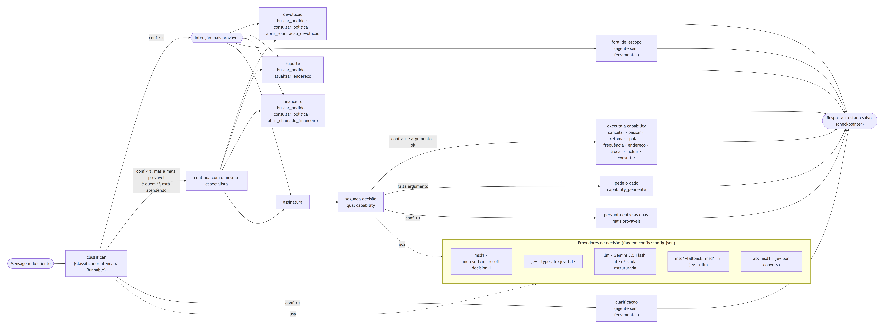
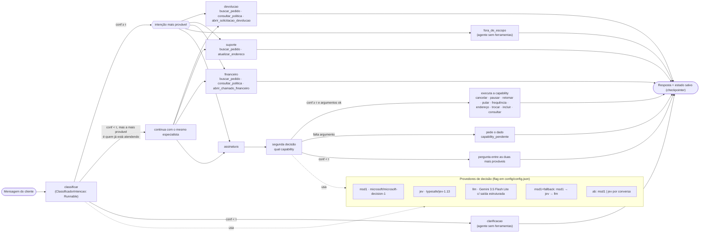
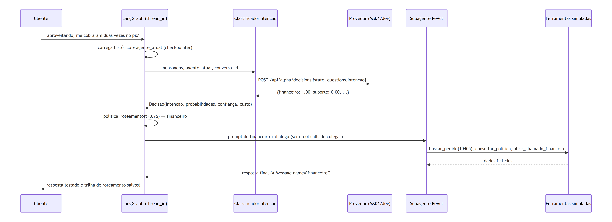
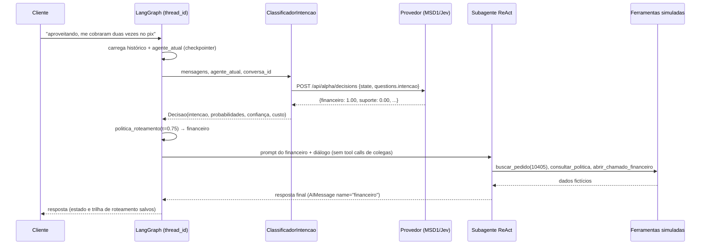
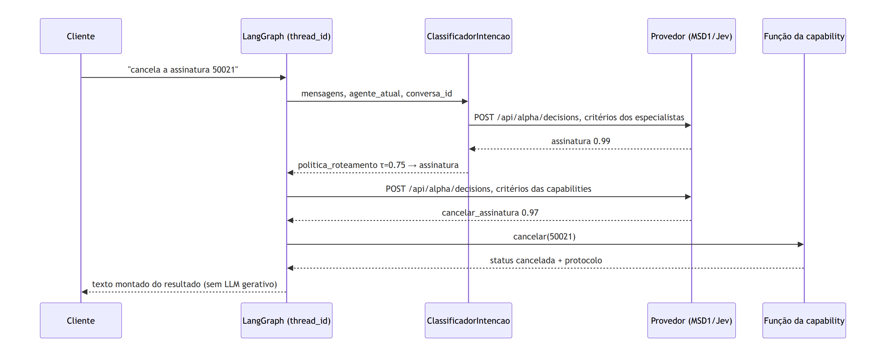
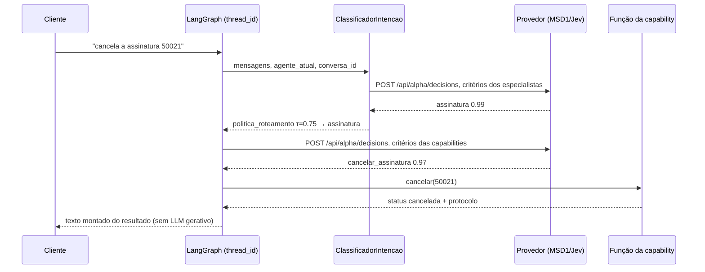

# Chatbot conversacional com LangGraph e um modelo de decisão como roteador

> Nesta POC eu monto um chatbot de pós-venda **conversacional** (LojaExemplo, loja fictícia) com **subagentes LangChain** (devolução, suporte, financeiro, além de clarificação e fora de escopo), em que o **Microsoft-Decision-1 (MSD1)** decide, a cada mensagem, qual subagente responde. A camada de decisão fica atrás de uma interface de provedor, e eu troco o MSD1 pelo **Jev** (TypeSafe) mudando só uma flag. O objetivo aqui é **arquitetura**, não benchmark de custo ou velocidade. Gastei **US$0,07** de API no total.


*Gravação real (Streamlit + OpenRouter, sem cortes, 40 s): a primeira mensagem fica abaixo do τ e vira clarificação, a segunda vai para devolução e a terceira troca de assunto para o financeiro. À direita, as probabilidades do MSD1 em cada turno.*

## Por que eu fiz isso

Quase todo tutorial de "multiagente" usa um LLM gerativo como roteador: um prompt "classifique a intenção e responda em JSON". Funciona, mas é caro, mais lento, devolve só um rótulo (sem distribuição de probabilidade) e às vezes quebra o formato. Eu queria saber como ficaria a arquitetura com um **modelo de decisão** no lugar: um modelo que não gera texto, só responde a perguntas tipadas sobre um estado e devolve **uma probabilidade por opção**. Com isso eu ganho um sinal de confiança de verdade para decidir quando pedir esclarecimento.

Uma coisa eu decidi desde o início: **nada de fluxo engessado**. O bot não tem menus, formulários nem uma sequência fixa de passos. O cliente escreve do jeito que quiser, o subagente é um agente de verdade (LLM com ferramentas) que decide sozinho o que perguntar e quando agir, e a cada mensagem o modelo de decisão responde só uma pergunta: *quem atende agora?* Com isso, troca de assunto, follow-up e clarificação acontecem dentro da própria conversa.

## Arquitetura


Desenhei o diagrama no estilo Excalidraw (rough.js + fonte Excalifont), com o código em [`docs/diagrama/`](docs/diagrama). Há também uma versão estática 1200×627 em [`evidencias/arquitetura-thumb.png`](evidencias/arquitetura-thumb.png). O mesmo fluxo em Mermaid:

[](evidencias/diagramas/grafo-roteamento.svg)

<details><summary>Fonte Mermaid</summary>



</details>

O LangGraph aqui faz **só orquestração de handoff**: um nó `classificar` e um nó por subagente, cada um terminando em `END`. O grafo não modela etapas do atendimento; a "etapa" em que a conversa está fica no histórico de mensagens, e quem cuida dela é o subagente. A exceção é `assinatura`: em vez de um ReAct, o mesmo provedor responde uma segunda pergunta (qual capability) e uma função executa. O GIF animado acima mostra o handoff entre subagentes; o Mermaid inclui esse segundo passo. O cenário, os números fictícios e o critério de cada capability estão em [`docs/capabilities.md`](docs/capabilities.md).

### Um turno, passo a passo

[](evidencias/diagramas/sequencia-turno.svg)

<details><summary>Fonte Mermaid</summary>



</details>

No turno de assinatura a segunda pergunta usa o mesmo endpoint e a mesma chave `questions.intencao`. O que muda é o critério: as capabilities, não os especialistas.

[](evidencias/diagramas/sequencia-capability.svg)

<details><summary>Fonte Mermaid</summary>



</details>

### Por que LangChain + LangGraph (em Python)

- **LangGraph** me dá, de graça, o que um chatbot multi-turno precisa e que eu não queria reescrever: estado tipado com reducers (`add_messages`), **checkpointer** por `thread_id` (memória da conversa) e arestas condicionais para o handoff. No pós-venda o grafo tem dois níveis (decidir → atender). Na assinatura entra um terceiro: decidir a capability e executar a função.
- **LangChain** padroniza as peças: o classificador é um `Runnable` (aparece em traces e aceita callbacks), as ferramentas são `@tool` e os subagentes saem do `create_react_agent`. Trocar o modelo gerativo é trocar um `ChatOpenAI` apontado para o OpenRouter.
- **Python**, porque o ecossistema LangGraph é mais maduro em Python e minha POC anterior já era em Python, o que me permitiu reaproveitar dados e conhecimento da API.

## Por que um modelo de decisão em vez de um LLM roteador

| | Modelo de decisão (MSD1/Jev) | LLM com saída estruturada |
|---|---|---|
| Saída | distribuição de probabilidade por opção, sempre no schema | rótulo + "nota" que o próprio LLM inventa |
| Clarificação | limiar direto sobre `p_max` | precisa de heurística ou de um prompt extra |
| Custo no meu conjunto de 76 turnos | US$0,0007 (MSD1) / US$0,0017 (Jev) | US$0,022 (~30× o MSD1) |
| Latência mediana | 232 ms (MSD1) / 195 ms (Jev) | 897 ms |
| Falha de formato | não se aplica | possível (mitiguei com JSON schema) |

O LLM não ficou atrás em acurácia no meu conjunto (veja a [avaliação](#avaliação-secundária)). O argumento a favor do modelo de decisão é **contrato + custo + latência + um sinal de confiança utilizável**, não "acerta mais".

## O que é o "Jev" e por que deu para trocar

Eu precisava confirmar se o Jev existia e se era compatível. Existe: é o **`typesafe/jev-1.13`** (alias `~typesafe/jev-latest`), o primeiro modelo "System One" da TypeSafe, lançado em 18/09/2026 e disponível no OpenRouter ([página do modelo](https://openrouter.ai/typesafe/jev-1.13), [documentação](https://openrouter.ai/docs/guides/community/jev)). Chamei os dois com o **mesmo payload** e confirmei que:

- usam o mesmo endpoint, `POST https://openrouter.ai/api/alpha/decisions`, com o mesmo corpo `{model, state, questions}` e os mesmos tipos de pergunta (`choice`, `score`, `noul`);
- devolvem a mesma resposta: `answers.<pergunta>.{choice, probabilities, confidence}` e `usage.cost`;
- têm o mesmo preço de tabela (US$0,042/M tokens de entrada, saída grátis). O Jev, porém, contabiliza mais tokens de entrada para o mesmo pedido (379 contra 79 na sonda), por isso saiu cerca de 2,5× mais caro na prática;
- o Jev também tem uma superfície própria (`/api/v1/systemone`, para o SDK da TypeSafe), que eu não usei. Existe ainda o `typesafe/jev-router`, que é outra coisa: um roteador de **modelos** de chat, não de intenção.

Resultado: para trocar de um para o outro basta mudar o `model`. Na prática, a diferença está na **calibração**. O Jev espalha mais a probabilidade nos casos de fronteira (ex.: `financeiro=0.62, devolucao=0.38`), enquanto o MSD1 tende a ir para 0,99+. Com isso, o mesmo τ gera taxas de clarificação diferentes (1,3% contra 6,6%). **O τ precisa ser calibrado por provedor.**

## Tour pelo código

```
roteador/
  decisao.py     # Decisao, provedores (OpenRouter decisões, LLM, fallback, A/B), fábrica e ClassificadorIntencao (Runnable)
  grafo.py       # Estado do LangGraph, politica_roteamento, nós e compilação com checkpointer
  agentes.py     # prompts e create_react_agent por subagente
  ferramentas.py # ferramentas simuladas (pedido, política, abrir devolução/chamado, endereço)
  capabilities.py # capabilities de assinatura: o modelo escolhe, o código executa
  assinaturas.py  # assinaturas fictícias e as funções das capabilities
  llm.py         # ChatOpenAI → OpenRouter + callback que alimenta o ledger
  orcamento.py   # ledger com teto rígido
  dados_loja.py  # pedidos e política 100% fictícios
scripts/ demo.py · avaliar.py · avaliar_capabilities.py · chat.py · screenshots.py
app.py           # interface Streamlit
```

**1. Um contrato, vários provedores.** Todo provedor implementa `decidir(estado, pergunta) -> Decisao`. MSD1 e Jev são a *mesma classe* com `model` diferente:

```python
class ProvedorOpenRouterDecisao:
    def decidir(self, estado, pergunta):
        self.ledger.reservar(...)                                  # trava de orçamento ANTES da chamada
        estado = {k: v for k, v in estado.items() if k != "conversa_id"}
        r = self.transporte({"model": self.modelo, "state": estado, "questions": {"intencao": pergunta}})
        self.ledger.registrar(self.modelo, r["usage"]["cost"])
        probs = r["answers"]["intencao"]["probabilities"]
        ...
```

O `transporte` é injetável. É assim que os testes rodam offline e que a demo simula uma queda do MSD1.

**2. Composição de provedores.** `ProvedorComFallback(primário, secundário)` cai para o próximo em qualquer erro (menos estouro de orçamento, que precisa parar tudo). `ProvedorAB` escolhe o braço pelo hash do `thread_id`, então a conversa inteira fica no mesmo provedor. A fábrica lê a flag:

```json
"decisao": { "provedor": "msd1", "modelos": {"msd1": "microsoft/microsoft-decision-1", "jev": "typesafe/jev-1.13"}, "tau": 0.75 }
```

`msd1+fallback` monta a cadeia `msd1 → jev → llm`.

**3. O classificador como Runnable.** `ClassificadorIntencao` monta o `state` a partir das mensagens: os últimos 6 turnos compactos, o especialista atual e a última mensagem do cliente. Mandar o histórico é o que faz "e quanto tempo demora?" cair no especialista certo.

**4. A política de roteamento** é uma função pura, com cinco casos cobertos por teste:

```python
def politica_roteamento(decisao, agente_atual, tau):
    if decisao.confianca >= tau:                       return decisao.intencao, "confiante"
    if agente_atual and decisao.intencao == agente_atual: return agente_atual, "continuidade"
    return "clarificacao", "baixa_confianca"
```

**5. Subagentes conversacionais.** Cada um é um `create_react_agent` com suas ferramentas. Ele recebe o diálogo (falas do cliente e respostas finais), mas **não** recebe as tool calls dos colegas: assim um agente não vê chamadas a ferramentas que ele nem tem. A resposta volta como `AIMessage(name=<subagente>)`, e o estado guarda `agente_atual` e uma `trilha` com a decisão de cada turno.

**6. Capabilities, só na assinatura.** Devolução, suporte e financeiro continuam subagentes. Se a intenção é `assinatura`, uma segunda decisão escolhe uma capability declarada (cancelar, trocar o produto, assinar outro, pausar, pular entrega, frequência, endereço) e o código executa. A documentação do cenário, dos números fictícios e de como testar está em [`docs/capabilities.md`](docs/capabilities.md).

## Como rodar

```bash
python -m venv .venv && . .venv/bin/activate && pip install -r requirements.txt
# .env na raiz do projeto (já está no .gitignore): OPENROUTER_API_KEY=...
# OPENAI_API_KEY no mesmo arquivo também vale, se OPENROUTER_API_KEY não estiver definida
pytest -q                                 # 31 testes, offline
python scripts/demo.py --provedor msd1    # conversas da demo (também: jev | llm | ab | msd1+fallback --simular-queda-msd1)
python scripts/avaliar.py                 # avaliação de roteamento msd1 × jev × llm
python scripts/avaliar_capabilities.py    # intenção + capability no conjunto de assinatura
python scripts/chat.py --provedor jev     # chat no terminal
streamlit run app.py                      # interface web
```

## Evidências (execuções reais, 12/10/2026)

Os traces completos (probabilidades, ferramentas, custo e latência por turno) estão em [`evidencias/traces/`](evidencias/traces), e as saídas de terminal em [`evidencias/`](evidencias).

**Troca de assunto no meio da conversa** ([MSD1](evidencias/terminal_demo_msd1.txt)):

```
👤 oi, meu tênis do pedido 10405 ainda não chegou, cadê?
   ↳ [msd1] suporte=1.00 ... → suporte (confiante)
   ↳ ferramentas: buscar_pedido({"numero_pedido": "10405"})
👤 aproveitando, vi que me cobraram duas vezes esse pedido no pix
   ↳ [msd1] financeiro=1.00 ... → financeiro (confiante)
   ↳ ferramentas: buscar_pedido(...); consultar_politica(...); abrir_chamado_financeiro({"valor": 349, "tipo": "estorno_duplicidade", ...})
👤 beleza, e em quanto tempo volta o dinheiro?
   ↳ [msd1] financeiro=1.00 ... → financeiro (confiante)
```

**Clarificação** ([MSD1](evidencias/terminal_demo_msd1_clarificacao.txt)): sem contexto, "não tô satisfeito" ficou abaixo do τ, e o bot perguntou de forma natural, sem menu:

```
👤 não tô satisfeito
   ↳ [msd1] devolucao=0.68 fora_de_escopo=0.32 ... | conf=0.68 τ=0.75 → clarificacao (baixa_confianca)
🤖 [clarificacao] Entendo. Para eu te ajudar da melhor forma, você gostaria de falar sobre a devolução de algum produto ou é sobre outro assunto?
👤 o fone do pedido 10418 parou de funcionar, quero trocar
   ↳ [msd1] devolucao=1.00 ... → devolucao (confiante)
```

Na interface com o Jev ([screenshot](evidencias/screenshots/ui_jev.png)), a mesma frase dita **depois** de uma conversa sobre devolução foi para `devolucao` com 100%. É o histórico desambiguando.

**Fora de escopo no meio e volta ao assunto**: "aliás, você sabe se vai chover amanhã em SP?" → `fora_de_escopo` (1.00). Logo depois, "ok rs. então o endereço já ficou certo né?" → `suporte` de novo, e o agente confirma o endereço que tinha atualizado dois turnos antes.

**Troca de provedor**: as mesmas conversas rodaram com [Jev](evidencias/terminal_demo_jev.txt), em [A/B](evidencias/terminal_demo_ab.txt) e com [fallback](evidencias/terminal_demo_fallback.txt). No fallback, simulei um 503 do MSD1 e todos os turnos foram atendidos pelo Jev, com `fallback: RuntimeError: HTTP 503 ... (queda simulada)` registrado no trace.

**Interface**: o [GIF do topo](evidencias/gifs/produto.gif) (gravado com `scripts/gravar_gif.py`) e as capturas [`ui_msd1.png`](evidencias/screenshots/ui_msd1.png) e [`ui_jev.png`](evidencias/screenshots/ui_jev.png), capturadas com Playwright em modo headless contra o Streamlit rodando localmente.

### Avaliação (secundária)

São 76 turnos fictícios ([`dados/avaliacao.jsonl`](dados/avaliacao.jsonl)): turnos de abertura, follow-ups curtos que dependem do histórico, trocas de assunto, linguagem informal e 8 casos que eu marquei como ambíguos (nesses, aceito clarificação como acerto). τ = 0,75. Resultados em [`evidencias/avaliacao/resumo.json`](evidencias/avaliacao/resumo.json).

| Provedor | Acurácia top-1 | Top-1 (não ambíguos) | Taxa de clarificação | Acerto entre os aceitos | Acerto da política* | Latência mediana | Custo |
|---|---|---|---|---|---|---|---|
| MSD1 | 98,7% | 100% | 1,3% | 98,7% | 98,7% | 232 ms | US$0,0007 |
| Jev | 96,1% | 100% | 6,6% | 98,6% | 97,4% | 195 ms | US$0,0017 |
| LLM (Gemini 3.5 Flash Lite, JSON schema) | 98,7% | 100% | 9,2% | 100% | 100% | 897 ms | US$0,0220 |

\* Acerto da política: rotear para o rótulo certo, ou clarificar num caso marcado como ambíguo.

Leio isso com cautela: **o conjunto é pequeno e fácil demais para separar os provedores**. Todos acertaram 100% dos casos não ambíguos, e as diferenças estão nos 8 ambíguos, cujo rótulo é discutível. Para mim, a avaliação mostra que a arquitetura funciona com qualquer um dos três. Ela não mostra qual é melhor.

### Avaliação das capabilities (24/10/2026)

São 27 turnos em [`dados/avaliacao_capabilities.jsonl`](dados/avaliacao_capabilities.jsonl): 20 de assinatura com capability definida, 2 que eu marquei como ambíguos ("mexer na assinatura", "ajustar a assinatura") e 5 que não são assinatura (endereço de pedido, cancelar pedido, cobrança duplicada, devolução, clima). τ = 0,75. A avaliação chama o modelo de decisão e **não executa** a capability. Resultado em [`evidencias/avaliacao_capabilities/resumo.json`](evidencias/avaliacao_capabilities/resumo.json).

| Provedor | Intenção top-1 (27) | Política da intenção (27) | Capability top-1 (20) | Política da capability (22) | Caminho completo (27) | Latência intenção | Latência capability | Custo |
|---|---|---|---|---|---|---|---|---|
| MSD1 | 92,6% | 88,9% | 95,0% | 86,4% | 77,8% | 463 ms | 467 ms | US$0,0006 |
| Jev | 96,3% | 96,3% | 100% | 95,5% | 92,6% | 352 ms | 353 ms | US$0,0013 |
| LLM (Gemini 3.5 Flash Lite) | 100% | 100% | 100% | 95,5% | 96,3% | 1549 ms | 1679 ms | US$0,0223 |

O caminho completo é o que o grafo faria: a primeira decisão chega na intenção rotulada e, se for assinatura, a política da capability escolhe o rótulo. Nos dois ambíguos, acerto é entrar em assinatura e não executar. A coluna de capability top-1 olha só os 20 não ambíguos, e a política da capability olha os 22 (inclui os ambíguos).

A segunda pergunta acerta mais do que o turno inteiro. Em "quando chega a próxima entrega da 50022?" os três modelos escolhem `consultar_assinatura` na capability, mas a primeira pergunta manda para suporte (MSD1, 0,87) ou clarifica (Jev, 0,70). O grafo nem faz a segunda chamada. "no lugar do café em grãos da 50021 manda sabonete" deixa o MSD1 em devolução com 0,75, e ele clarifica; a capability responderia `trocar_produto` com 0,99. "as próximas entregas da 50021 vão para Rua Harmonia..." o MSD1 fica entre consultar (0,56) e mudar o endereço, e clarifica. "quero a ração da 50022 uma vez por mês" o Jev acerta `alterar_frequencia` com 0,66, abaixo do τ, e clarifica.

Nos ambíguos, o MSD1 executaria `consultar_assinatura` com 0,98 nas duas frases. O LLM faz o mesmo em "mexer" (0,80) e clarifica "ajustar". O Jev clarifica os dois. Consultar é uma leitura possível; o rótulo ambíguo é o meu.

Rodei de novo os 76 turnos originais com `assinatura` no critério ([`evidencias/avaliacao_intencao_com_assinatura/resumo.json`](evidencias/avaliacao_intencao_com_assinatura/resumo.json)). Nenhum provedor classificou esses turnos como assinatura. A acurácia dos não ambíguos continuou 100%. A tabela de 12/10 acima continua sendo a rodada original. Nesta repetição o MSD1 ficou em 98,7% (clarificação 0%), o Jev em 94,7% (6,6%) e o LLM em 97,4% (10,5%). A diferença para 12/10 está nos ambíguos e na latência desta execução.

Esta rodada custou US$0,024 no conjunto de capabilities e US$0,030 na repetição dos 76.

### Custo

| | US$ |
|---|---|
| Ledger local (`runs/ledger.json`, 479 chamadas, incluindo a gravação do GIF) | 0,0709 |
| Gemini 3.5 Flash Lite (subagentes + classificador LLM) | 0,0667 |
| Jev | 0,0029 |
| MSD1 | 0,0013 |
| Diferença no `GET /api/v1/key` antes/depois | 0,0709 |

O teto da POC era **US$3** (com parada em US$2,80). O ledger reserva o custo máximo estimado antes de cada chamada e registra o `usage.cost` real depois. No fim, o ledger bateu com o valor reportado pela conta.

## Lições que eu tirei

1. **O roteador é a parte fácil; o subagente é a difícil.** Os dois modelos de decisão quase não erraram a intenção. Os problemas que eu vi estavam nas respostas: o Flash Lite chamou `atualizar_endereco` com um endereço provisório antes de o cliente informar o novo (corrigi com uma regra na docstring da ferramenta) e, num turno, repetiu que o pagamento tinha sido via Pix quando o cliente disse "cartão" (aí o dado do sistema estava certo). Na gravação do GIF, o financeiro abriu um chamado de "cobrança duplicada" para o pedido 10418 sem conferir que a base registra só uma cobrança; eu deixei o GIF sem cortes justamente para mostrar isso. O próximo passo seria a ferramenta recusar o chamado quando o dado não confirma a duplicidade.
2. **O agente de clarificação desobedece.** Mesmo com "NÃO responda ao mérito", o Flash Lite às vezes respondeu à pergunta de reembolso em vez de esclarecer, inclusive com prazo impreciso, já que ele não tem ferramentas. Na próxima versão eu faria a clarificação sem LLM (pergunta montada a partir dos dois candidatos mais prováveis) ou passaria só a última mensagem para ele.
3. **O τ é por provedor, não por arquitetura.** O MSD1 é bem mais "decidido" que o Jev. Com o mesmo τ, o Jev pede esclarecimento cinco vezes mais. Se eu fosse trocar de provedor em produção, recalibraria o τ num conjunto de validação antes.
4. **Mandar o histórico para o modelo de decisão é essencial.** Sem ele, "pode abrir sim" ou "tem protocolo?" não têm intenção. Com 6 turnos de contexto, os 12 follow-ups do conjunto foram 100% roteados pelos três provedores.
5. **A regra de "continuidade"** (baixa confiança, mas a mais provável é quem já está atendendo) evita clarificações chatas no meio de um assunto, sem prender a conversa: se a intenção muda com confiança, o handoff acontece.
6. **Isolar as tool calls entre subagentes** evitou erros de "ferramenta desconhecida" quando um agente herda o histórico de outro.

## Limitações

- **Os dados são 100% fictícios.** Os 76 turnos de avaliação e os rótulos foram escritos com apoio de LLM e **não passaram por revisão humana**. Os 27 turnos de capability também são fictícios. Os casos "ambíguos" refletem o meu julgamento.
- O conjunto é pequeno e não tem poder estatístico para comparar provedores.
- As ferramentas são simuladas. Não há autenticação do cliente nem efeitos reais.
- A memória (`MemorySaver`) fica em processo. Em produção eu trocaria por um checkpointer persistente (Postgres/Redis).
- O endpoint de decisões do OpenRouter está em **alpha**. O contrato pode mudar, e por isso o fallback para um classificador LLM existe.
- Não implementei handoff "dentro" do subagente (ex.: o financeiro devolvendo para a devolução). Toda troca passa pelo classificador no turno seguinte.
