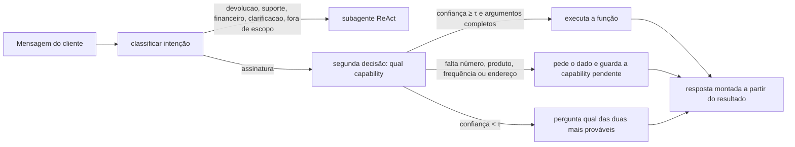

# Capabilities na assinatura recorrente

O roteamento por especialista continua igual: devolução, suporte e financeiro são subagentes ReAct. Este caminho é outro. Quando a intenção é `assinatura`, o grafo não entrega a conversa para um agente escolher ferramenta. Ele faz uma segunda pergunta ao mesmo modelo de decisão, agora com as capabilities como opções, e o código executa a que foi escolhida.

Uma capability aqui é só isto: um nome, uma descrição (o critério que o modelo lê) e uma função. Ela não conversa e não decide o próximo passo.



São duas chamadas ao provedor de decisão no turno de assinatura. A primeira escolhe o especialista. A segunda escolhe a capability. τ é o mesmo da configuração (0,75).

## O que o cliente consegue fazer

Não há CPF nem cadastro. A chave é o número da assinatura, no mesmo espírito do número de pedido. Pedido `10405` não serve como assinatura.

| Número | Situação | Serve para experimentar |
|---|---|---|
| 50021 | Café em grãos 250g, mensal, ativa, próxima em 03/11/2026 | cancelar, pausar, trocar o produto |
| 50022 | Ração cães 3kg, quinzenal, ativa | mudar frequência ou endereço |
| 50023 | Cápsulas de café, pausada | retomar; pular entrega é recusado |
| 50024 | Filtro de água, já cancelada | ver a recusa ao cancelar de novo |
| 50025 | Shampoo, semanal, próxima em 27/10/2026 | pular uma entrega |

Catálogo para troca ou nova assinatura: Café em grãos 250g, Cápsulas de café, Ração cães 3kg, Shampoo, Filtro de água, Sabonete líquido.

| Capability | O que faz |
|---|---|
| `consultar_assinatura` | Lê status, produto, ritmo, próxima data e endereço |
| `cancelar_assinatura` | Encerra. Sem próxima entrega |
| `pausar_assinatura` | Empurra a próxima data em um ou mais ciclos |
| `retomar_assinatura` | Só sai de `pausada` |
| `pular_proxima_entrega` | Adia uma entrega e mantém a assinatura ativa |
| `alterar_frequencia` | Semanal, quinzenal ou mensal. A próxima data não muda |
| `alterar_endereco_entrega` | Endereço das próximas entregas da recorrência |
| `trocar_produto` | Troca o produto desta assinatura |
| `incluir_assinatura` | Abre outra assinatura, no mesmo endereço, sem cancelar a atual |

`atualizar_endereco` de pedido avulso continua no subagente de suporte, e só vale para pedido `processando`. Endereço de assinatura cai aqui.

## Como a escolha acontece

1. Confiança ≥ τ: executa a capability mais provável.
2. A mensagem só completa o que faltava (em geral o número) e não pede outra coisa: executa a capability pendente, com motivo `pendente`.
3. Confiança baixa, mas a mais provável é a pendente: continua nela.
4. Nos outros casos: não executa e pergunta entre as duas mais prováveis.

Se a capability está escolhida e falta um argumento, nada é executado. O estado `capability_pendente` guarda o nome até o próximo turno. Se o cliente muda de assunto e cai em suporte, devolução ou financeiro, a pendência é apagada.

A resposta não passa por um LLM. Ela sai do resultado da função (`Cancelei a assinatura 50021...`, protocolo `CAN-50021-001`). Os dados mudam na memória do processo; reiniciar o programa volta à base fictícia.

## Avaliação (24/10/2026)

O fluxo está medido em [`dados/avaliacao_capabilities.jsonl`](../dados/avaliacao_capabilities.jsonl) (27 turnos) e o resultado em [`evidencias/avaliacao_capabilities/resumo.json`](../evidencias/avaliacao_capabilities/resumo.json). τ = 0,75. A medição chama o modelo de decisão e não executa a função.

| Provedor | Intenção top-1 (27) | Capability top-1 (20) | Política da capability (22) | Caminho completo (27) | Custo |
|---|---|---|---|---|---|
| MSD1 | 92,6% | 95,0% | 86,4% | 77,8% | US$0,0006 |
| Jev | 96,3% | 100% | 95,5% | 92,6% | US$0,0013 |
| LLM | 100% | 100% | 95,5% | 96,3% | US$0,0223 |

Caminho completo: a primeira decisão acerta a intenção e, na assinatura, a política da capability acerta o rótulo. Nos ambíguos, a capability não executa. A segunda pergunta, sozinha, vai melhor do que o turno inteiro: "quando chega a próxima entrega da 50022?" vira suporte na primeira decisão e `consultar_assinatura` na segunda. Os 76 turnos antigos, refeitos com a intenção nova no critério, não foram para `assinatura`. Detalhe e a repetição dos 76 estão no README.

```bash
python scripts/avaliar_capabilities.py
```

## Como testar

Os testes não chamam a API:

```bash
pytest -q tests/test_capabilities.py
```

No chat ou no Streamlit, com a chave no `.env`, duas frases bastam:

```text
quero cancelar minha assinatura
50021
```

A primeira fica abaixo da execução e pede o número. A segunda cancela a 50021. Outras:

```text
quero trocar o produto da assinatura 50021 para shampoo
quero assinar outro produto, o shampoo, mantendo a 50021
pula a próxima entrega da 50025
muda o endereço da assinatura 50022 para Rua Nova, 10, Recife
```

O painel de roteamento mostra a intenção `assinatura` e, embaixo, a capability, o motivo e se ela chegou a executar.
